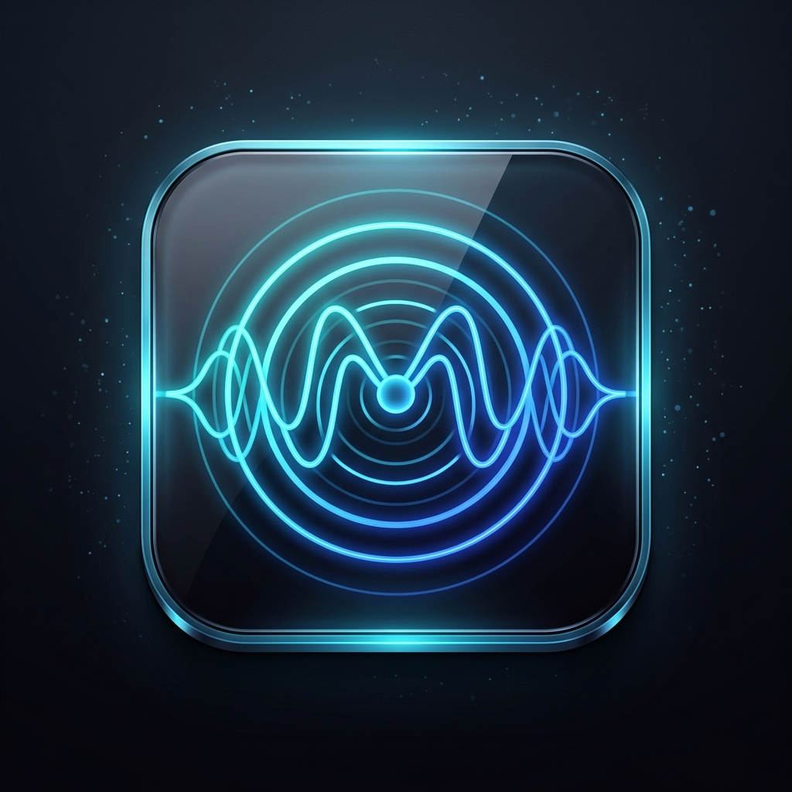
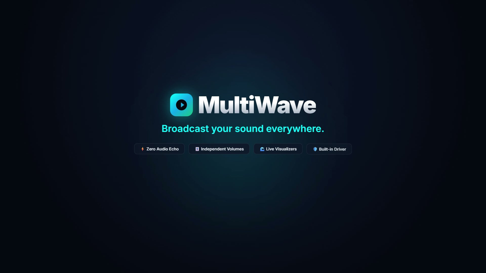
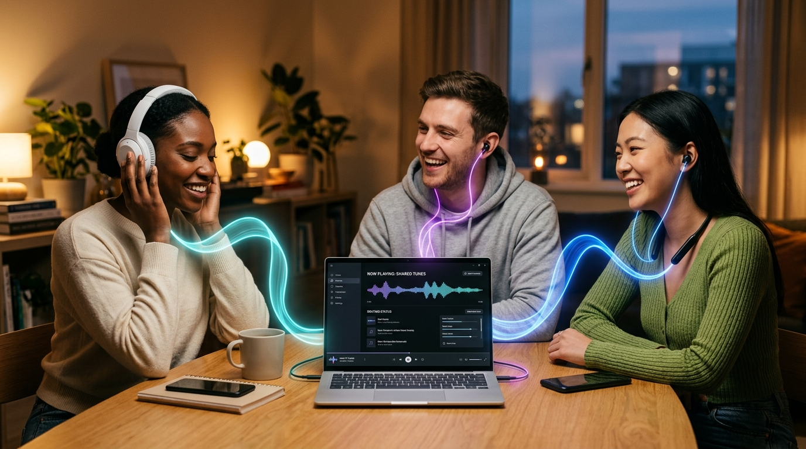
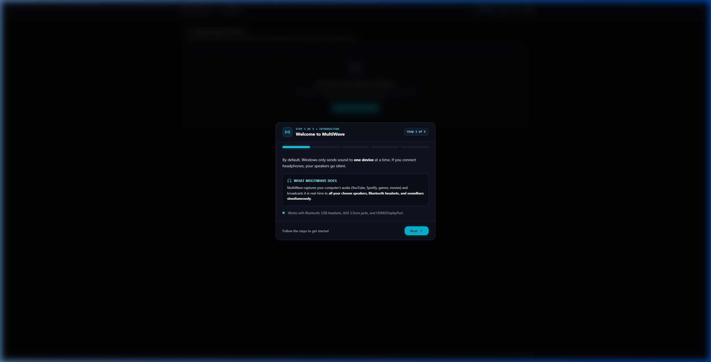
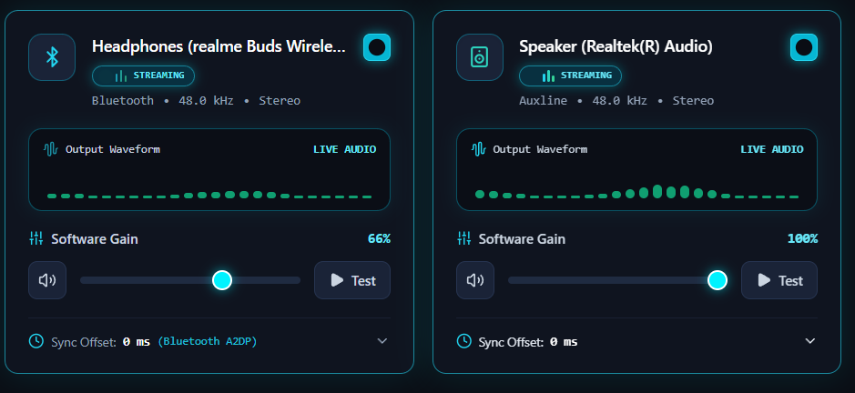
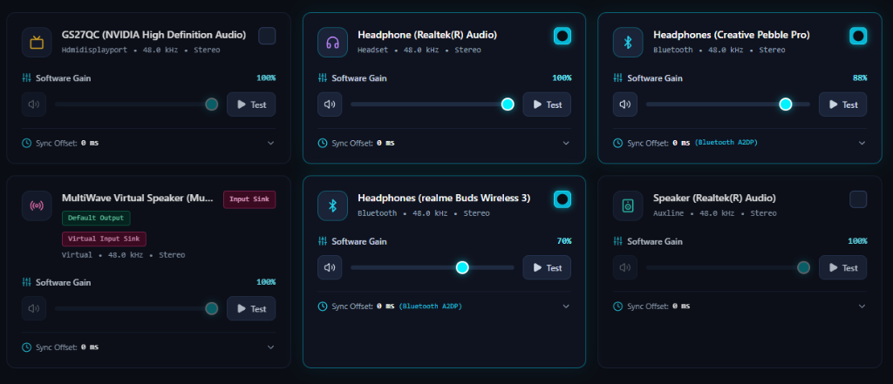

<p align="center">
  
</p>

<h1 align="center">MultiWave</h1>

<p align="center">
  <strong>macOS & Windows Multi-Device Audio Output Routing & Synchronization</strong><br>
  <em>Simultaneous audio streaming across AirPods, Bluetooth headphones, USB DACs, 3.5mm, and HDMI endpoints with zero latency mismatch.</em>
</p>

<p align="center">
  <a href="http://multiwave.pritamjoardar.com/"><strong>🌐 Official Website</strong></a> &nbsp;|&nbsp;
  <a href="https://github.com/pritamjoardar/Multiwave"><strong>⭐ GitHub Repository</strong></a> &nbsp;|&nbsp;
  <a href="public/MultiWave_0.1.0_macOS.dmg"><strong>🍏 macOS Installer (.dmg)</strong></a> &nbsp;|&nbsp;
  <a href="public/MultiWave_0.1.0_x64-setup.exe"><strong>🪟 Windows Installer (.exe)</strong></a> &nbsp;|&nbsp;
  <a href="USER_GUIDE.md"><strong>Read User Guide »</strong></a>
</p>

---

## 🎥 Product Overview Video

<p align="center">
  <video src="public/multiwave.mp4" controls width="740" poster="docs/images/brag_poster.jpg">
    <a href="public/multiwave.mp4">
      
    </a>
  </video>
  <br>
  <em>🎬 <strong>Watch the 22-Second MultiWave Overview Video (with Audio & Human Voice Narration)</strong></em>
</p>

---

## 🎧 The Multi-Device Audio Sharing Concept

<p align="center">
  
  <br>
  <em>🎧 <strong>One Laptop, Multiple Listeners:</strong> Stream computer audio simultaneously to multiple people with their own individual earbuds, over-ear headphones, and neckbands — each with independent volume control and zero acoustic latency mismatch.</em>
</p>

---

## 📸 Application Showcase

<p align="center">
  <strong>Interactive Step-by-Step User Guide (In-App)</strong><br>
  
</p>

<p align="center">
  <strong>Live Reactive Audio Waveforms & Independent Gain Controls</strong><br>
  
</p>

<p align="center">
  <strong>Windows Audio Routing Bridge & Multi-Device Grid</strong><br>
  
</p>

---

## Key Features

- **Real-Time Windows Device Enumeration**: Discovers all active Core Audio render endpoints using Windows COM APIs (`IMMDeviceEnumerator`, `IMMDevice`, `IMMEndpoint`).
- **Accurate Device Classification**: Automatically categorizes endpoints into **Bluetooth**, **USB**, **AUX / Line Out**, **Headset**, **HDMI / DisplayPort**, or **Virtual Audio** by inspecting `PKEY_AudioEndpoint_FormFactor` and device interface paths.
- **Dynamic Device Change Notifications**: Integrated native COM `IMMNotificationClient` listens for `OnDeviceStateChanged`, `OnDeviceAdded`, `OnDeviceRemoved`, and `OnDefaultDeviceChanged`, instantly synchronizing the UI when Bluetooth devices connect or USB cables are unplugged.
- **Simultaneous Multi-Device Playback**: Opens dedicated WASAPI shared-mode streams for each selected output device, converting and routing shared PCM audio in real-time.
- **Heterogeneous Sample Rate & Channel Resampling**: Custom real-time resamplers and channel layout converters handle differing device configurations (44.1 kHz, 48 kHz, 96 kHz, 192 kHz; Mono, Stereo, 5.1/7.1) without blocking audio threads.
- **Independent Per-Device Software Gain**: Independent volume sliders (0% to 100%) mapped via perceptual cubic curves ($G = v^{2.5}$), with independent mute toggles and single-sample soft limiters to prevent harsh digital clipping. MultiWave software gain is clearly distinguished from Windows hardware endpoint volume.
- **Bluetooth Synchronization Strategy**: Built-in ring-buffer delay compensation (0–500 ms) allows delaying low-latency wired outputs to acoustically align with wireless Bluetooth A2DP buffering.
- **Multi-Tone Audio Generators**: Built-in harmonic C-Major chord, melodic arpeggio chime, 440 Hz / 880 Hz sine tones, and Paul Kellet filtered pink noise for multi-speaker verification.
- **Settings Persistence**: User preferences, selected devices, individual volume levels, and delay offsets persist locally in `%APPDATA%\MultiWave\settings.json`.
- **Per-Application Audio Routing Architecture**: Documented architectural extension point using Windows 10/11 Process Loopback Capture (`ActivateAudioInterfaceAsync` with `AUDIOCLIENT_ACTIVATION_PARAMS` `PROCESS_LOOPBACK_MODE`).

---

## 📚 User Guide & Documentation

For a comprehensive beginner-friendly walkthrough with detailed steps and screenshots, see our **[Step-by-Step First-Time User Guide](USER_GUIDE.md)**.

---

## Architecture Overview

```
MultiWave (Tauri 2 Desktop Application)
│
├── Frontend (React 18 + TypeScript + Vite + Tailwind CSS)
│   ├── components/
│   │   ├── Header.tsx                 # Status indicators, Play/Pause toggle, rescan, and settings
│   │   ├── DeviceCard.tsx             # Per-device sliders, mute, latency sync, test tone
│   │   ├── DeviceWaveVisualizer.tsx   # Dynamic real-time audio wave meter reacting to audio signal
│   │   └── SettingsModal.tsx          # Themes (Dark/Light), virtual audio routing, and about info
│   ├── hooks/useAudioMixer.ts         # Central state management & event listener hook
│   └── services/tauriService.ts       # Typed IPC bridge to Tauri backend commands
│
└── Backend (Cross-Platform Rust Core Audio Engine)
    ├── macos/                         # macOS CoreAudio Native Integration
    │   ├── core_audio.rs              # macOS CoreAudio device enumeration & classification
    │   ├── device_notifications.rs    # Dynamic Bluetooth/USB connection monitor & event emitter
    │   └── policy_config.rs           # macOS default audio device switcher & Sound Settings opener
    ├── windows/                       # Windows WASAPI Core Audio Native Integration
    │   ├── core_audio.rs              # IMMDeviceEnumerator, endpoint property extraction
    │   ├── device_notifications.rs    # IMMNotificationClient COM event sink
    │   └── policy_config.rs           # IPolicyConfig COM interface default audio router
    ├── audio/
    │   ├── device_manager.rs          # Cross-maps native platform CoreAudio with cpal host
    │   ├── playback_engine.rs         # Master playback engine coordinating simultaneous output streams
    │   ├── output_stream.rs           # Dedicated cpal::Stream per device
    │   ├── resampler.rs               # Real-time linear sample rate converter & channel mapper
    │   ├── volume.rs                  # Perceptual volume curves and soft-knee limiters
    │   └── audio_mixer.rs             # Multi-tone generators & ring-buffer delay lines
    ├── commands/                      # Typed Tauri IPC commands
    └── persistence/config_store.rs    # Cross-platform config store (macOS ~/Library/ & Windows %APPDATA%)
```

---

## Prerequisites

### A. For MacBook & macOS (Apple Silicon M1-M4 & Intel):
1. **Xcode Command Line Tools**:
   ```bash
   xcode-select --install
   ```
2. **Rust Toolchain**:
   ```bash
   curl --proto '=https' --tlsv1.2 -sSf https://sh.rustup.rs | sh
   ```
3. **Node.js**:
   - Node.js 18+ (`brew install node`).
4. **Virtual Audio Driver (for loopback capture)**:
   - Automated via `install_virtual_speaker_mac.sh` or `brew install blackhole-2ch`.

### B. For Windows:
1. **Rust Toolchain**:
   - Install Rust via [rustup.rs](https://win.rustup.rs/) (`x86_64-pc-windows-msvc`).
2. **Node.js**:
   - Node.js 18+ (tested with Node.js v22.12.0 and npm 10.9.0).
3. **C++ Build Tools**:
   - Visual Studio 2022 Build Tools with Desktop development with C++.
4. **WebView2**:
   - Pre-installed on Windows 10 and 11.

---

## Step-by-Step Instructions: How to Run

### 1. Run Development Desktop Application
To launch the full desktop application with the native Windows Core Audio engine:

```powershell
# In PowerShell (from project root):
$env:PATH = "$env:USERPROFILE\.cargo\bin;$env:PATH"

# Run Tauri development mode:
npm run tauri dev
```
> **What this does:**
> - Starts the Vite dev server for hot-reloading React.
> - Compiles the Rust backend with Windows Core Audio APIs and WASAPI.
> - Launches the native desktop window with multi-device playback.

### 2. Run Web UI Preview (Without Native Audio)
If you only want to inspect UI layouts in your web browser:
```powershell
npm run dev
```

### 3. Run Automated Rust Unit Tests
MultiWave includes unit tests for volume clamping, perceptual gain calculations, mute logic, soft limiting, channel mapping (mono/stereo/5.1), resampling, and delay line synchronization:

```powershell
$env:PATH = "$env:USERPROFILE\.cargo\bin;$env:PATH"
cd src-tauri
cargo test
```

### 4. Production Release Installers & Packages

| Platform | Format | File Name | Architecture | Download Link |
|---|---|---|---|---|
| **macOS** | Disk Image (`.dmg`) | `MultiWave_0.1.0_macOS.dmg` | Apple Silicon (M1-M4) & Intel | [**Download .dmg**](public/MultiWave_0.1.0_macOS.dmg) (15.6 MB) |
| **macOS** | Portable (`.zip`) | `MultiWave_0.1.0_macOS.zip` | Universal macOS Application | [**Download .zip**](public/MultiWave_0.1.0_macOS.zip) (15.5 MB) |
| **Windows** | Setup Installer (`.exe`) | `MultiWave_0.1.0_x64-setup.exe` | x64 (Windows 10 & 11) | [**Download .exe**](public/MultiWave_0.1.0_x64-setup.exe) (7.7 MB) |
| **Windows** | Portable (`.exe`) | `multiwave.exe` | x64 Standalone Executable | [**Download Standalone**](src-tauri/target/release/multiwave.exe) (10.0 MB) |


> [!TIP]
> - 🌐 **Official Product Website**: [http://multiwave.pritamjoardar.com/](http://multiwave.pritamjoardar.com/)
> - 🍏 **macOS Installer (`.dmg`)**: [`public/MultiWave_0.1.0_macOS.dmg`](file:///c:/Users/prita/OneDrive/Desktop/MultiWave/public/MultiWave_0.1.0_macOS.dmg)
> - 🪟 **Windows Installer (`.exe`)**: [`public/MultiWave_0.1.0_x64-setup.exe`](file:///c:/Users/prita/OneDrive/Desktop/MultiWave/public/MultiWave_0.1.0_x64-setup.exe)

#### macOS Installation:
1. Mount `MultiWave_0.1.0_macOS.dmg`.
2. Drag `MultiWave.app` to `/Applications`.
3. Open MultiWave. If Apple Gatekeeper warns about an unidentified developer, right-click `MultiWave.app` and select **Open**, or run:
   ```bash
   xattr -cr /Applications/MultiWave.app
   ```
4. Allow Microphone / Loopback permission when prompted.

#### How to Rebuild for macOS:
```bash
# Automated packager (.dmg & .zip):
python package_mac.py

# Native shell script:
chmod +x build_mac.sh
./build_mac.sh

# Or with npm / Tauri:
npm run build:mac      # builds both .app and .dmg
npm run build:mac:dmg  # builds installer .dmg
```

#### How to Rebuild for Windows:
```powershell
# Method A: Double-click launcher
build_exe.bat

# Method B: PowerShell script
.\build_exe.ps1 -Installer  # outputs to src-tauri\target\release\bundle\nsis\MultiWave_0.1.0_x64-setup.exe
.\build_exe.ps1             # outputs to src-tauri\target\release\multiwave.exe

# Method C: npm scripts
npm run build:installer
npm run build:exe
```


---

## Understanding Bluetooth Latency & Synchronization

Bluetooth audio transmission operates over the **A2DP** profile (using SBC, AAC, or LDAC codecs). This inherently incurs **120 ms to 220 ms** of wireless transmission and DSP buffering inside the Bluetooth speaker/headphone hardware. In comparison, wired 3.5mm AUX or USB DACs have a hardware buffer latency of only **5 ms to 20 ms**.

If audio is played through both a wired AUX speaker and a Bluetooth speaker without compensation, the wired speaker will sound slightly ahead of the Bluetooth speaker.

### MultiWave's Solution:
1. MultiWave implements an independent **Sync Delay Line** (0 to 500 ms) on every output.
2. In the device card, expand the **Sync Offset** slider on your wired speaker.
3. Add **120 ms to 180 ms** of delay to the wired output. The sound from both speakers will now reach your ears simultaneously!

---

## Advanced Feature: Per-Application Audio Routing

Routing audio from individual third-party applications (e.g. Chrome → Bluetooth, Spotify → Headphones) requires intercepting audio before it reaches the Windows default output device.

MultiWave provides a documented extension point based on Microsoft's **Process Loopback Capture API** introduced in Windows 10 Build 20348+ and Windows 11:
- `ActivateAudioInterfaceAsync` initialized with `AUDIOCLIENT_ACTIVATION_PARAMS` (`PROCESS_LOOPBACK_MODE_INCLUDE_TARGET_PROCESS_TREE`).
- Captures raw PCM audio frames directly from a targeted Process ID.
- Feeds the captured frames into MultiWave's `Resampler` and `OutputStream` distribution pipeline.
- Click the **App Routing** button in the top navigation bar of MultiWave to explore the full architectural diagram.

---

## Troubleshooting

- **No audio devices found:** Ensure your devices are enabled in Windows Sound Settings (`mmsys.cpl`). Click the **Refresh** button in MultiWave's header to re-enumerate endpoints.
- **Device disconnected during playback:** MultiWave cleanly handles device disconnection events without crashing. When the device is plugged back in or reconnects over Bluetooth, click **Refresh** or **Play Selected**.
- **Build fails on missing Rust:** If `cargo` is not recognized, run:
  ```powershell
  $env:PATH = "$env:USERPROFILE\.cargo\bin;$env:PATH"
  ```
- **Windows Core Audio COM Error:** Ensure Windows Audio service (`Audiosrv`) is running in `services.mms`.

---

## License & Open Source

This project is open-source under the **MIT License** for individual use.  
- **GitHub Repository**: [https://github.com/pritamjoardar/Multiwave](https://github.com/pritamjoardar/Multiwave)  
- **Official Website**: [http://multiwave.pritamjoardar.com/](http://multiwave.pritamjoardar.com/)  
- **Author**: [Pritam Joardar](https://www.pritamjoardar.com/)
