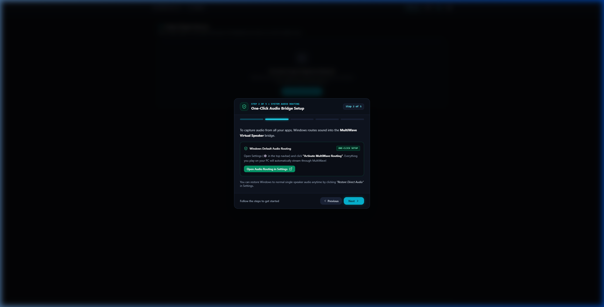
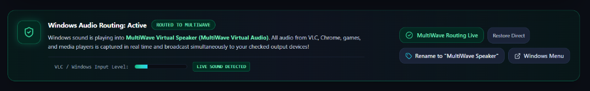
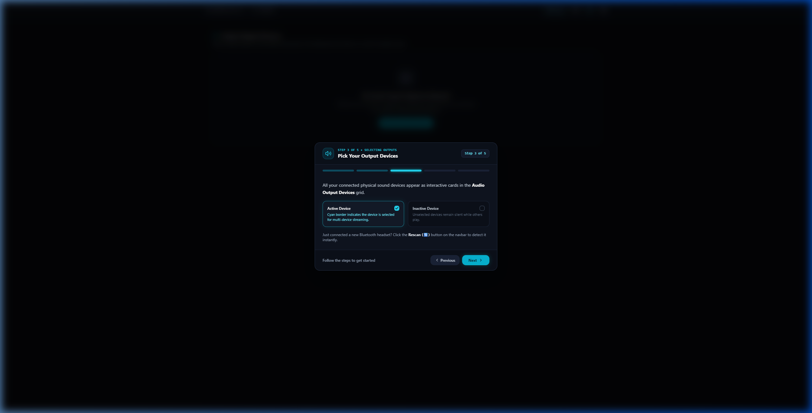
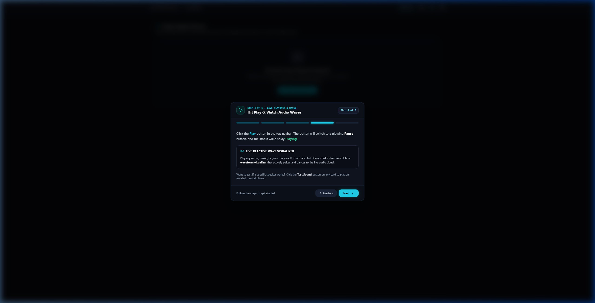
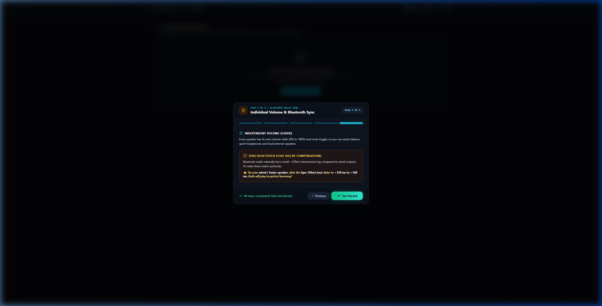

# 🌊 MultiWave — First-Time User Guide

<p align="center">
  
</p>

<p align="center">
  <strong>Simultaneous macOS & Windows Multi-Device Audio Routing & Real-Time Synchronization</strong><br>
  <em>Stream computer audio simultaneously across AirPods, Bluetooth headphones, USB DACs, and built-in speakers with zero latency mismatch.</em>
</p>

<p align="center">
  <video src="public/multiwave.mp4" controls width="720" poster="docs/images/brag_poster.jpg">
    <a href="public/multiwave.mp4">
      
    </a>
  </video>
  <br>
  <em>🎬 <strong>Watch the 22-Second MultiWave Overview Video (with Audio & Human Voice Narration)</strong></em>
</p>

<p align="center">
  <a href="http://multiwave.pritamjoardar.com/"><strong>🌐 Official Website</strong></a> &nbsp;|&nbsp;
  <a href="https://github.com/pritamjoardar/Multiwave"><strong>⭐ GitHub Repository</strong></a> &nbsp;|&nbsp;
  <a href="public/MultiWave_0.1.0_macOS.dmg"><strong>🍏 macOS Installer (.dmg)</strong></a> &nbsp;|&nbsp;
  <a href="public/MultiWave_0.1.0_x64-setup.exe"><strong>🪟 Windows Installer (.exe)</strong></a> &nbsp;|&nbsp;
  <a href="#-macbook--macos-quickstart--permissions"><strong>🍎 MacBook (macOS) Guide »</strong></a>
</p>

---

## 📖 What is MultiWave?

By default, macOS and Windows only allow audio to play through **one single audio output device** at a time. If you connect headphones, your speakers go silent. If you connect a Bluetooth speaker, your headphones turn off.

**MultiWave solves this!** It is a high-performance cross-platform audio routing and synchronization engine (using Apple CoreAudio on macOS and WASAPI on Windows) that lets you broadcast and stream your computer's audio (YouTube, Spotify, Apple Music, games, movies, system sounds) across **multiple audio outputs simultaneously** — with:
- **Zero audio lag or echo** (via built-in Bluetooth delay compensation).
- **Independent volume controls** for each individual speaker or headphone.
- **Live reactive audio wave visualizers** that dance to the rhythm of your audio.
- **Instant hardware testing chimes** to identify every speaker.

<p align="center">
  
  <br>
  <em>🎧 <strong>One Laptop, Multiple Listeners:</strong> Share music, movies, or presentations simultaneously with friends or team members using different audio devices — wireless earbuds, over-ear studio headphones, and neckbands — all synchronized in real-time.</em>
</p>

---

## 🚀 Step-by-Step: Your First Time Setup

### Step 1: First-Time Launch & Interactive Welcome Guide

When you open MultiWave for the very first time, the application automatically launches an **interactive step-by-step onboarding guide** directly on your screen:

<p align="center">
  
</p>

1. **Top Navbar**:
   - **Status Indicators**: Shows how many devices are selected and whether playback is `Playing` or `Paused / Stopped`.
   - **Play / Pause Button**: Starts or pauses multi-device audio broadcasting.
   - **Rescan Button (🔄)**: Scans Windows for newly plugged in or connected audio devices.
   - **Guide Button (❓)**: Re-opens this interactive guide anytime you need a refresher.
   - **Settings Button (⚙️)**: Opens themes, audio driver routing, and application preferences.
2. **Audio Output Devices Grid**:
   - Displays all your physical audio endpoints (Laptop Speakers, Bluetooth Headphones, USB Headsets, AUX/Line Out, HDMI monitors).

---

### Step 2: One-Click System Audio Routing Setup

To let MultiWave capture and broadcast audio from all your Windows apps (Chrome, Spotify, VLC, games), you need to set MultiWave as your Windows audio bridge:

<p align="center">
  
</p>

1. You can click **"Open Audio Routing in Settings"** directly from Step 2 of the guide (or click the **⚙️ Settings** icon on the navbar).
2. In the **Windows Default Audio Routing** section:
   - **Automatic Virtual Speaker Setup**: MultiWave automatically includes and provisions its built-in **MultiWave Virtual Speaker** bridge on startup. If ever needed, click **"Enable MultiWave Virtual Speaker"** in Settings.
   - **Click "Activate MultiWave Routing"**: This sets **MultiWave Virtual Speaker** as your Windows default audio device.
3. Once activated, the status badge glows green with **`ROUTED TO MULTIWAVE`**:

<p align="center">
  
</p>

> **Note:** Whenever MultiWave is routed, everything you play on your computer goes directly into MultiWave to be shared across your selected outputs! If you ever want to return Windows to normal single-speaker mode, open Settings and click **"Restore Direct Audio"**.

---

### Step 3: Connect and Select Your Audio Output Devices

<p align="center">
  
</p>

1. Connect all the audio devices you want to use to your PC (e.g., plug in wired speakers and pair your Bluetooth headphones or soundbars).
2. If you paired a new Bluetooth device while MultiWave was open, click the **Rescan (🔄)** button on the top navbar.
3. **Select Your Devices**:
   - Simply click on the card of any device you want sound to play through.
   - Selected cards will highlight with a **cyan border** and display a crisp **Checkmark icon (✓)** in the top right.
   - You can select two, three, four, or as many devices as your computer supports:

<p align="center">
  
</p>

---

### Step 4: Start Multi-Device Playback

<p align="center">
  
</p>

1. Click the **Play** button on the top navbar.
2. The button will switch to a glowing cyan **Pause** button, and the navbar status will change to **`Playing (X active)`**.
3. Open any audio on your computer (play a music track on Spotify, a video on YouTube, or a movie).
4. **The sound will play out of all your selected devices at the exact same time!**
5. Notice that each active device card will display a **live audio wave visualizer** that reacts in real-time to the beats and dynamics of your audio:

<p align="center">
  
</p>

---

### Step 5: Adjust Volume & Mute for Each Speaker Individually

Different headphones and speakers have different loudness levels. MultiWave gives you full, independent control:

- **Per-Device Volume Slider (0% – 100%)**:
  Drag the slider on any card to adjust its sound level. For example, set your external Bluetooth soundbar to 80% and your headphones to 35%.
- **Instant Mute Toggle**:
  Click the **Speaker icon** on any card to mute or unmute that specific device instantly without interrupting audio on your other speakers.

---

### Step 6: Eliminate Bluetooth Audio Echo (Delay Sync)

<p align="center">
  
</p>

#### Why do Bluetooth speakers lag?
Bluetooth audio transmission wirelessly buffers audio (typically introducing **100 ms to 180 ms** of wireless delay). If you play sound through a wired speaker and a Bluetooth speaker simultaneously, the wired speaker will play slightly ahead, creating an annoying echo effect.

#### How to fix it in MultiWave:
1. Find the card for your **wired / faster speaker** (e.g. Laptop Speakers or AUX Speakers).
2. Locate the **Sync Offset / Delay (ms)** slider at the bottom of the card.
3. Slide it to add **120 ms to 160 ms** of delay.
4. Listen to the audio — the wired speaker and Bluetooth speaker will now hit your ears in **perfect acoustic synchronization**!

---

### Step 7: Test Your Output Devices

Not sure which device corresponds to which card?
- Click the **Test Sound** button on any device card.
- MultiWave will play a brief, pleasant melodic chord chime exclusively through that specific device so you can instantly verify it.

---

### Step 8: Personalize Theme & Settings

Click the **Settings (⚙️)** button in the top navbar:
- **Application Theme**:
  - **Studio Dark**: Premium obsidian dark studio aesthetic with glowing cyan accents.
  - **Studio Light**: Clean, modern white daylight studio theme.
- **About MultiWave**:
  - View application architecture and credits to **Pritam Joardar** (with a clickable link to [pritamjoardar.com](https://www.pritamjoardar.com/)).
- **Automatic Persistence**:
  - Every time you change device selections, volume levels, delay sync values, or themes, MultiWave automatically saves your preferences locally (`%APPDATA%\MultiWave\settings.json` on Windows or `~/Library/Application Support/MultiWave/settings.json` on macOS).
  - Next time you open MultiWave, all your settings are restored automatically!

---

## 🍎 MacBook & macOS Quickstart & Permissions

MultiWave runs natively on macOS (Apple Silicon M1/M2/M3/M4 & Intel MacBooks/Macs), integrating directly with **Apple CoreAudio**.

### 1. Download MultiWave for macOS
You can download and run the ready macOS packages directly:
- 🍏 **macOS Disk Image Installer (`.dmg`)**:  
  👉 [`public/MultiWave_0.1.0_macOS.dmg`](file:///c:/Users/prita/OneDrive/Desktop/MultiWave/public/MultiWave_0.1.0_macOS.dmg) *(Mountable Apple Disk Image with Applications drag-and-drop)*
- 📦 **macOS Portable Application Archive (`.zip`)**:  
  👉 [`public/MultiWave_0.1.0_macOS.zip`](file:///c:/Users/prita/OneDrive/Desktop/MultiWave/public/MultiWave_0.1.0_macOS.zip) *(Unzip and run directly)*
- 📱 **macOS Application Bundle (`.app`)**:  
  👉 [`src-tauri/target/release/bundle/macos/MultiWave.app`](file:///c:/Users/prita/OneDrive/Desktop/MultiWave/src-tauri/target/release/bundle/macos/MultiWave.app)

#### Installation on macOS:
1. Double-click **`MultiWave_0.1.0_macOS.dmg`** to open the disk image window.
2. Drag **`MultiWave.app`** into your **`Applications`** folder.
3. Launch **MultiWave** from Applications or Spotlight (`Cmd + Space` > type `MultiWave`).
4. **Apple Gatekeeper / First-Time Open Note**: If macOS shows an alert stating the app cannot be opened because it is from an unidentified developer:
   - **Method A**: Right-click (or Control-click) `MultiWave.app` in Finder and select **Open** > click **Open**.
   - **Method B (Terminal)**: Run:
     ```bash
     xattr -cr /Applications/MultiWave.app
     ```

---

### 2. Mandatory macOS Microphone / Loopback Permission
macOS protects audio capture devices through strict sandboxing and user consent permissions:
- When you first run MultiWave or start loopback broadcast, macOS displays an authorization dialog:
  > **"MultiWave" would like to access the microphone.**
- Click **"OK" / "Allow"**.
- If you accidentally clicked "Don't Allow" or need to verify:
  1. Open **System Settings** ( Apple Menu > System Settings).
  2. Navigate to **Privacy & Security** > **Microphone**.
  3. Ensure the toggle switch for **MultiWave** is turned **ON (Enabled)**.

> [!NOTE]
> *Why is microphone permission needed?* MultiWave captures your computer's audio loopback stream so it can route and sync music, videos, and game sounds across all your connected outputs. In macOS CoreAudio security architecture, all system audio capture endpoints are categorized under microphone permissions.

---

### 3. macOS Virtual Audio Driver Setup (BlackHole 2ch)
Unlike Windows which provides WASAPI loopback, macOS requires a virtual audio loopback driver to capture system-wide sound from apps without physical loop cables.
MultiWave uses **BlackHole 2ch** (the standard signed open-source macOS audio driver):

#### Automated Setup (Fastest):
In MultiWave, open **Settings (⚙️)** > click **"Enable MultiWave Virtual Speaker"**. MultiWave runs `install_virtual_speaker_mac.sh` to install and kickstart the CoreAudio daemon automatically.

#### Manual Terminal Setup:
```bash
# Using Homebrew:
brew install blackhole-2ch

# Or run the included script:
chmod +x install_virtual_speaker_mac.sh
./install_virtual_speaker_mac.sh
```

---

### 4. Setting Up Audio in macOS Audio MIDI Setup
1. In MultiWave, click **"Open System Sound Settings & Audio MIDI Setup"** in Settings.
2. In **Audio MIDI Setup**, you will see **BlackHole 2ch** / **MultiWave Virtual Speaker**.
3. Set your system sound output to **BlackHole 2ch**.
4. MultiWave captures sound from BlackHole and broadcasts it simultaneously to:
   - **AirPods / AirPods Pro / AirPods Max**
   - **MacBook Pro / MacBook Air Built-in Speakers**
   - **External 3.5mm Headphones**
   - **USB Audio DACs / Interfaces (Focusrite, Scarlett, FiiO)**
   - **HDMI / Thunderbolt Displays (Studio Display, LG UltraFine, Dell)**

---

### 5. How to Build & Package for macOS:
```bash
# Development mode:
npm run tauri dev

# Build production macOS Application (.app) and Disk Image (.dmg):
chmod +x build_mac.sh
./build_mac.sh

# Or with automated packager:
python package_mac.py

# Or with npm:
npm run build:mac      # builds both .app and .dmg
npm run build:mac:dmg  # builds installer .dmg
```
Output packages will be generated in:
- `public/MultiWave_0.1.0_macOS.dmg` & `src-tauri/target/release/bundle/dmg/MultiWave_0.1.0_macOS.dmg`
- `public/MultiWave_0.1.0_macOS.zip` & `src-tauri/target/release/bundle/dmg/MultiWave_0.1.0_macOS.zip`
- `src-tauri/target/release/bundle/macos/MultiWave.app`

---

## ❓ Frequently Asked Questions & Troubleshooting

### Q1: I don't hear any sound from my devices.
1. Make sure you clicked the **Play** button on the top navbar (status should say `Playing`).
2. Make sure you selected at least one device (the card has a cyan border and checkmark).
3. Open **Settings (⚙️)** and verify that System Default Audio Routing says **`ROUTED TO MULTIWAVE`**.
4. Check that your device volume sliders in MultiWave are turned up (not at 0%) and not muted.

### Q2: I plugged in my headphones or connected Bluetooth, but it's not showing.
- Click the **Rescan (🔄)** button on the top navbar. MultiWave will re-query the native CoreAudio / WASAPI endpoint manager and list the new device immediately.

### Q3: How do I switch back to normal computer audio?
- Open **Settings (⚙️)** in MultiWave and click **"Restore Direct Audio"**. Your computer will immediately switch back to sending sound directly to your physical speakers.

### Q4: Where are the macOS and Windows download files and how do I build them?
- **Official Website**: Visit [http://multiwave.pritamjoardar.com/](http://multiwave.pritamjoardar.com/) for online downloads, feature overviews, and updates.
- **Ready-to-Use macOS Packages**:
  - 🍏 **macOS Disk Image (`.dmg`)**: [`public/MultiWave_0.1.0_macOS.dmg`](file:///c:/Users/prita/OneDrive/Desktop/MultiWave/public/MultiWave_0.1.0_macOS.dmg) (15.6 MB)
  - 📦 **macOS Portable Archive (`.zip`)**: [`public/MultiWave_0.1.0_macOS.zip`](file:///c:/Users/prita/OneDrive/Desktop/MultiWave/public/MultiWave_0.1.0_macOS.zip) (15.5 MB)
  - 📱 **macOS App Bundle (`.app`)**: [`src-tauri/target/release/bundle/macos/MultiWave.app`](file:///c:/Users/prita/OneDrive/Desktop/MultiWave/src-tauri/target/release/bundle/macos/MultiWave.app)
- **Ready-to-Use Windows Packages**:
  - 🪟 **Windows Setup Installer (`.exe`)**: [`public/MultiWave_0.1.0_x64-setup.exe`](file:///c:/Users/prita/OneDrive/Desktop/MultiWave/public/MultiWave_0.1.0_x64-setup.exe) *(7.7 MB — with desktop shortcuts & virtual driver)*
  - ⚡ **Portable Standalone (`.exe`)**: [`src-tauri/target/release/multiwave.exe`](file:///c:/Users/prita/OneDrive/Desktop/MultiWave/src-tauri/target/release/multiwave.exe)
- **How to Rebuild macOS**:
  ```bash
  chmod +x build_mac.sh && ./build_mac.sh
  # or
  python package_mac.py
  ```
- **How to Rebuild Windows**:
  ```powershell
  # Full Windows Setup Installer (.exe):
  .\build_exe.ps1 -Installer

  # Standalone portable .exe:
  .\build_exe.ps1
  ```

---

*MultiWave is crafted with ❤️ by Pritam Joardar.*

